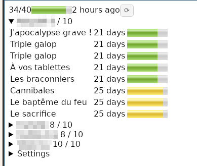

A web page to get the list of loans on the Saint-Paul library (France, La reunion).

In summary, this is a limited access to https://mediatheques-saintpaul.re, for
multiple account, allowing to list your books and how much time you can keep
them, as well as renew them or see the list of reservations.

With a bit of setup, it should also work for any "Iguana" based library
website, look for `iguana_root` in the code. Unfortunately, for now, it uses a
proxy which is not configurable.

# Features:

- Automated login process for multiple accounts
- Recover the list of book and how much time you can keep them
- Loan renewal
- List of reservations

# Usage:

That's a web application, which can be found at [Saint Paul Books](https://guibou.github.io/saint_paul_books/).

You'll have to fill the setting panel credentials with your login/password from the library, such as:

Fill the `credentials.json` file as such:

```json
[
  {
    "credential": {"login": "X0000000001", "password": "01010101"},
    "displayName": "Laureline"
  },
  {
    "credential": {"login": "X0000000001", "password": "02020202"},
    "displayName": "Xena"
  }
]
```

Here is an (outdate) screenshot of the application.



# Development

```
nix develop
cabal repl

:main
-- Open your browser (does not work on firefox) at https://localhost:8000
```

You can build the javascript application using `nix build .#javascript`. This is actually what is done in CI and deployed to github pages.

# A note about the proxy

The library web API does not set the correct `Access-Control-Allow-Origin *`, hence it is not possible to query the API using web technologies.

Initially, this was developed as an android application (using reflex-platform
and native sockets, so no cross origin policy issues), but this was really
painful to deploy.

I wrote a small proxy in cloudfare which adds the required headers. The
freetier of cloudfare is enough for my needs, hence it was turned into a full
web application.
